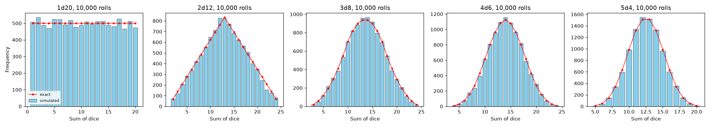
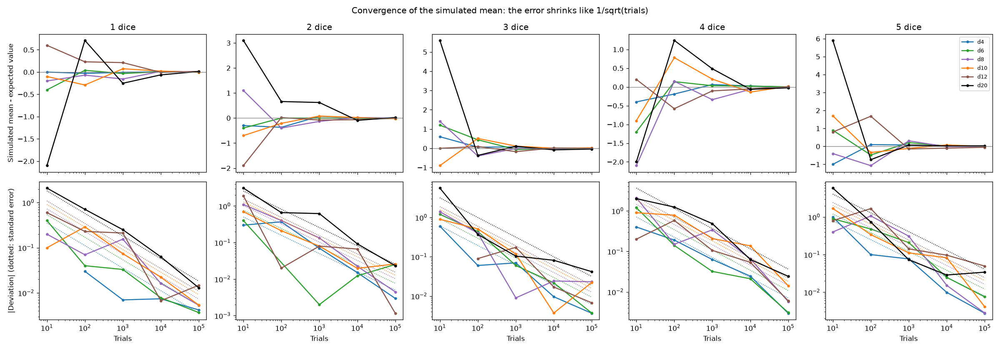
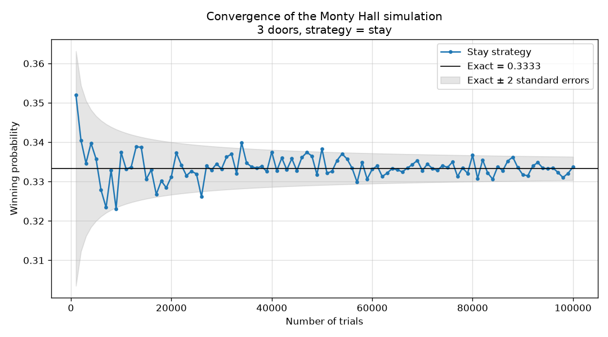

# Monte Carlo Simulations: Dice Sums and the Monty Hall Problem

[](https://github.com/chahatpatel2003/monte-carlo-dice-and-monty-hall/actions/workflows/tests.yml)

Two Monte Carlo studies from CSCI 154 (Simulation) at California State University, Fresno, Summer 2025.
Both are checked against exact probabilities, not just eyeballed.

1. **Dice sums.** Roll 1–5 dice with 4, 6, 8, 10, 12 or 20 sides, 10 to 100,000 times. Measure how quickly the simulated mean converges to its expected value and how the distribution of the sum changes shape.
2. **Monty Hall.** Stay or switch with 3, 6, 9, 20 and 100 doors. An "unpredictable" variant lets the host open a door at random with probability *r*, so the game can be ruined.

## Technical highlights

| Area | What the code does | From |
|---|---|---|
| Experiment design | Sweeps 150 dice configurations (6 die types × 1–5 dice × 5 trial counts) and compares each simulated mean with its expected value | 2025 project |
| Simulation modelling | Simulates the standard and the random-host Monty Hall games for any number of doors, tracking games the host ruins | 2025 project (Monty Hall code reconstructed) |
| Probability theory in code | Exact distribution of a dice sum by discrete convolution; closed-form win and ruin probabilities for *N* doors and host error *r* | Added 2026 |
| Statistical validation | Standard errors, z-scores and χ² goodness-of-fit tests check the simulations, and the report's recovered tables, against exact results | Added 2026 |
| Engineering | Vectorised, seeded NumPy; command-line interfaces; headless plotting; 27 pytest tests; CI on Python 3.11–3.13 with a lint check | Added 2026 |

**Stack:** Python, NumPy, pandas, Matplotlib, pytest, Ruff, GitHub Actions.

## What is original and what is not

The project files were recovered from Google Drive in October 2026. Not everything survived, so each file is labelled.

| File | Status |
|---|---|
| `original/dice_simulation_original.py` | **Recovered original.** The dice code, extracted verbatim from the appendix of the project report (a Colab export). It is unchanged and runs as-is; a test runs it. |
| `dice_simulation.py` | **Cleaned version of the recovered original.** It runs the same experiment with the same output columns, plus a seed, headless plotting, exact distributions and standard errors. |
| `monty_hall.py` | **Reconstruction.** The original Monty Hall code was not recovered. This module was rewritten in October 2026 (AI-assisted) from the report's description of the model. Its exact probabilities are tested against the result tables saved in the report. |
| `original/report_figures/` | **Recovered original results.** The six Monty Hall result figures from the report. |
| `data/recovered_report_tables.csv` | The tables in those figures, transcribed by hand. |

Full details are in [PROVENANCE.md](PROVENANCE.md).

## Results

### Dice: the error shrinks like 1/√N, not exponentially

The standard error of the mean of *N* rolls of *d* dice with *s* sides is √(*d*(*s*² − 1)/12 / *N*). Each tenfold increase in trials should therefore cut the typical deviation by about √10 ≈ 3.2.

The seeded run (`python dice_simulation.py`, seed 154) gives these deviations across all 30 dice configurations:

| Trials | Median deviation | Median standard error |
|---:|---:|---:|
| 10 | 0.90 | 1.27 |
| 100 | 0.355 | 0.40 |
| 1,000 | 0.105 | 0.127 |
| 10,000 | 0.022 | 0.040 |
| 100,000 | 0.0059 | 0.0127 |

Every one of the 150 configurations is within 3.3 standard errors of its expected value.

At 100,000 trials, 18 of 30 configurations have a deviation below 0.01. The theoretical expectation is about 58%: a 1d4 has a standard error of 0.0035, while a 5d20 has 0.041 and usually stays above 0.01.

The original report described the deviation as dropping "exponentially" and said most setups were below 0.01. The first claim is corrected here. The second holds only for the low-variance configurations.




### Monty Hall: switching helps only when the host's door carries information

The exact probabilities, used by the tests, are:

| | Stay | Switch |
|---|---|---|
| Standard game | 1/*N* | (*N*−1) / (*N*(*N*−2)) |
| Unpredictable game, ruined games excluded | 1/(*N*−*r*) | (*N*−1)/*N* · ((1−*r*)/(*N*−2) + *r*/(*N*−1)) / (1 − *r*/*N*) |
| P(ruined game) | | *r*/*N* |

Results with 100,000 games per cell and host error *r* = 0.1. The original column is from report Figure 3, where *r* = 0.1 is inferred from its ruined-game rates.

| Doors | Switch, exact | Switch, original report | Switch, this reconstruction | Ruined, exact | Ruined, original | Ruined, reconstruction |
|---:|---:|---:|---:|---:|---:|---:|
| 3 | 0.66667 | 0.66415 | 0.66762 | 0.03333 | 0.03342 | 0.03323 |
| 6 | 0.20833 | 0.20830 | 0.20728 | 0.01667 | 0.01629 | 0.01695 |
| 9 | 0.12698 | 0.12886 | 0.12882 | 0.01111 | 0.01034 | 0.01072 |
| 20 | 0.05278 | 0.05169 | 0.05243 | 0.00500 | 0.00479 | 0.00513 |
| 100 | 0.01010 | 0.01059 | 0.01023 | 0.00100 | 0.00097 | 0.00119 |

The 25 values in each of the report's two 100,000-game tables (*r* = 0.1 and *r* = 1) agree with the exact model. The fit statistics are χ² = 31.0 and 28.8 on 25 degrees of freedom, with the largest |z| = 2.3. See `tests/test_recovered_report.py`.

- **Standard game:** switching always wins more often. The advantage shrinks from 2× at 3 doors to about 1% at 100 doors, because the host reveals only one of the *N* − 2 non-chosen, non-prize doors.
- **Host who always errs (*r* = 1):** if the game isn't ruined, stay and switch both win with probability 1/(*N* − 1) for every number of doors. The opened door carries no information about the prize, so switching has no advantage. With 3 doors that is the 50/50 result in the report.



For comparison, the report's own convergence plot is `original/report_figures/monty_hall_fig6_convergence.png`.

## Run it

```bash
python3 -m pip install -r requirements.txt
python dice_simulation.py                    # results/dice/: summary CSV, histograms, convergence plot (~1 s)
python monty_hall.py                         # results/monty_hall/: r = 0.1 tables and convergence plot (~5 s)
python monty_hall.py --host-error 1 --no-plots
python -m pytest                             # 27 tests (~5 s)
```

`requirements.txt` gives minimum versions. `requirements-lock.txt` pins the exact versions the tests were last run with locally (Python 3.12). The tests have also passed locally on Python 3.13, and GitHub Actions runs them on Python 3.11, 3.12 and 3.13 on every push.

The recovered original can also be run directly; it writes `dice_roll_summary.csv` to the current directory:

```bash
MPLBACKEND=Agg python original/dice_simulation_original.py
```

## Repository structure

```text
.
├── dice_simulation.py            cleaned version of the recovered dice code
├── monty_hall.py                 reconstructed Monty Hall simulation
├── original/
│   ├── dice_simulation_original.py   recovered original (unchanged)
│   └── report_figures/               Monty Hall result figures from the report
├── data/recovered_report_tables.csv  report tables, transcribed
├── results/                      outputs of the seeded runs above
├── tests/
├── .github/workflows/tests.yml   CI: pytest on Python 3.11–3.13, plus Ruff
├── PROVENANCE.md
├── requirements.txt              minimum versions
└── requirements-lock.txt         exact versions last tested
```
